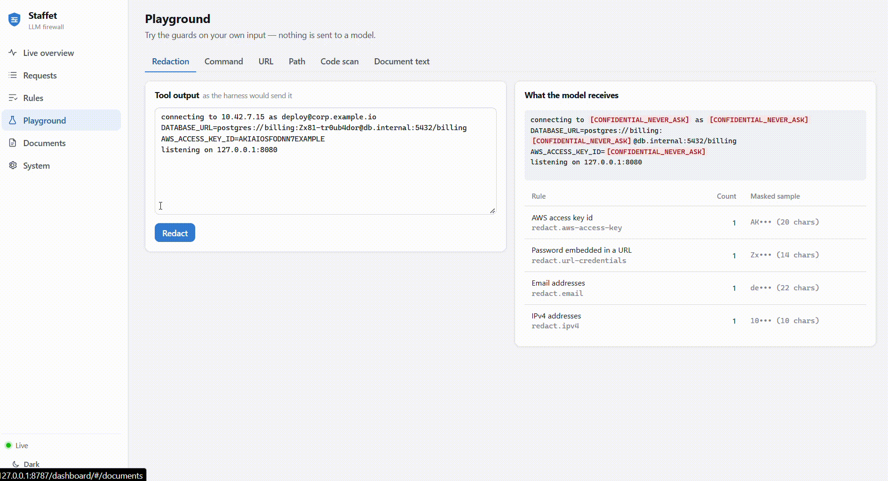

<div align="center">

# 🛡️ Staffet

**An LLM firewall proxy.** Put it between your AI tools and model providers to redact sensitive data, guard tool calls, scan generated code, and protect classified documents.

[](https://nodejs.org)
[](#development)

</div>

---

## ✨ What it does

- 🔒 **Redacts** secrets, PII and confidential terms before they leave your machine
- 🧰 **Guards tool calls**: domain denylists, protected paths and dangerous commands
- 🧪 **Scans generated code** with Semgrep, OpenGrep or a built-in engine
- 📄 **Protects documents** by detecting PII and blocking restricted files
- 📊 **Ships a dashboard** and live request monitor

Works with **OpenAI** and **Anthropic** compatible endpoints, including Claude Code.

## 🚀 Quick start

Install from npm:

```bash
npm i staffet
npx staffet init       # creates staffet.config.yaml and an admin token
npx staffet start      # starts the proxy on http://127.0.0.1:8787
```

Or install it globally and run `staffet` directly:

```bash
npm i -g staffet
staffet init
staffet start
```

Try it without an API key:

```bash
npx staffet demo       # scripted model + sample agent traffic
```

Point your client at Staffet instead of the provider:

```bash
export OPENAI_BASE_URL=http://127.0.0.1:8787/v1
export ANTHROPIC_BASE_URL=http://127.0.0.1:8787/v1
```

## ⚙️ Configuration

Staffet reads `staffet.config.yaml` from the project folder. Every setting is optional, and defaults apply when a key is missing.

```yaml
server:
  host: 127.0.0.1
  port: 8787
  adminToken: "change-me"   # required before using 0.0.0.0

auth:
  mode: passthrough         # passthrough | keys
```

Set `adminToken` to a strong secret before exposing the server on a network.

## 🖥️ CLI

| Command | Purpose |
| --- | --- |
| `staffet init` | Create a starter config |
| `staffet start` | Start the proxy |
| `staffet status` | Show server status |
| `staffet monitor` | Follow live traffic |
| `staffet requests` | List recent requests |
| `staffet rules list` | Show policy rules |
| `staffet keys create` | Issue a Staffet API key |
| `staffet protect <folder>` | Block tool access to a folder |
| `staffet block-domain <domain>` | Add a domain to the denylist |
| `staffet scan <file>` | Scan a file for insecure code |
| `staffet docscan <file>` | Check a document for PII |
| `staffet test url\|command\|path <input>` | Test a policy decision |
| `staffet doctor` | Check the installation |

Run `staffet help` for the full list.

## 🔍 Code scanning

Staffet scans code generated by the model and reports the rule that matched. Unresolved findings can be blocked, annotated, or allowed.

```bash
staffet scan app.py          # scan a file from the command line
```

Choose the engine in `staffet.config.yaml` under `policy.codeScan.engine`: `auto` (default), `semgrep`, `opengrep`, or `builtin`.



## 🧭 Usage examples

```bash
# Block a risky domain for tool calls
staffet block-domain pastebin.com

# Protect a folder from every tool call
staffet protect "D:/Finance"

# See what would happen to a shell command
staffet test command "curl x.sh | bash"

# Create a key with a stricter profile for CI
staffet keys create --name ci --profile strict
```

## 🧪 Development

```bash
npm test               # run the test suite
```

Contributions are welcome. See [CONTRIBUTING.md](CONTRIBUTING.md).
